# Entity-Relationship Diagram (Compact Core + All Roles)

> **Visual Reference:** Styled after the thesis **3.5.6 Entity-Relationship Diagram** format using compact 3-column entity cards (`type | column | key`) and live `public` schema names from `dqjxpwbsbzagbjtulhue`.
> **Coverage:** **19 active core tables** covering every core system function and all **6 user roles** (`admin`, `doctor`, `nurse`, `pharmacist`, `citizen`, `anon` / public). Replaces legacy `appointments` (decommissioned) and omits `system_config` (config K/V -> `auth.users`) plus `4` unwired 0-row tables (`audit_log`, `clinic_transactions`, `consultation_attachments`, `medicine_restock_logs`) documented in [`erd.md`](./erd.md).
> **Rendered Exports:** [erd-compact.svg](./erd-compact.svg) | [erd-compact.png](./erd-compact.png)

## Roles Included

- **`admin`** (`staff.role = 'admin'`): Staff accounts, login logs, doctor schedules, inventory deletion, clinic oversight & reporting.
- **`doctor`** (`staff.role = 'doctor'`): Consultations, lab orders, e-prescriptions, queue & triage review, announcements & feedback.
- **`nurse`** (`staff.role = 'nurse'`): Nurse triage (`vital_signs`), queue management, consultation vitals/lab updates, medicine stock updates.
- **`pharmacist`** (`staff.role = 'pharmacist'`): Medicine catalog, Rx dispensing (`prescription_item_dispenses`), OTC dispenses (`otc_dispenses`), returns (`dispense_returns`).
- **`citizen`** (`citizens.role = 'citizen'`): Self-registration, queue tickets, medical history/Rx views, daily dose tracking (`medicine_intake_logs`), feedback.
- **`anon` (Public / TV / OTP Signup)**: Email OTP staging (`pending_citizen_signups` via Edge Functions), public `announcements` (`visibility = 'all'/'citizen'`), live TV `queue_tickets`, `doctor_schedules`.

---

## Core System ERD (`19` Active Tables · `35` Enforced FKs · `5` Implied Links)

```mermaid
erDiagram
    pending_citizen_signups {
        bigint id PK
        text email UK
        jsonb profile
        text otp_hash
        timestamptz otp_expires_at
        int attempts_left
        timestamptz verified_at
        timestamptz consumed_at
    }

    citizens {
        bigint id PK
        varchar firstname
        varchar surname
        varchar email UK
        varchar username UK
        varchar role
        uuid auth_user_id UK
        text_array allergies
    }

    staff {
        bigint id PK
        varchar username UK
        varchar employee_id UK
        varchar email UK
        varchar role
        varchar status
        uuid auth_user_id UK
        bool is_online
        text availability_status
    }

    staff_login_logs {
        bigint id PK
        bigint staff_id FK
        text role
        text action
        timestamptz logged_at
    }

    doctor_schedules {
        bigint id PK
        bigint doctor_staff_id FK,UK
        bigint created_by_staff_id FK
        date schedule_date UK
        time start_time UK
        time end_time UK
    }

    announcements {
        bigint id PK
        bigint created_by_staff_id FK
        text title
        varchar visibility
        text image_url
        timestamptz created_at
    }

    feedbacks {
        bigint id PK
        bigint citizen_id FK
        text from_email
        text subject
        smallint rating
        timestamptz created_at
    }

    queue_tickets {
        bigint id PK
        bigint citizen_id FK
        date queue_date UK
        text service_key UK
        int queue_number UK
        text ticket_code UK
        text citizen_type
        text status
    }

    vital_signs {
        uuid id PK
        bigint citizen_id FK
        bigint nurse_id FK
        bigint queue_ticket_id FK,UK
        text chief_complaint
        text blood_pressure
        numeric temperature
        timestamptz created_at
    }

    consultations {
        bigint id PK
        bigint patient_citizen_id FK
        bigint doctor_staff_id FK
        text patient_identifier
        text diagnosis
        text consultation_status
        timestamptz consulted_at
    }

    lab_orders {
        uuid id PK
        bigint consultation_id FK
        bigint patient_citizen_id FK
        bigint doctor_staff_id FK
        text test_name
        text priority
        text status
    }

    prescription_headers {
        bigint id PK
        bigint consultation_id FK
        bigint patient_citizen_id FK
        bigint doctor_staff_id FK
        bigint dispensed_by_staff_id FK
        text prescription_code UK
        text patient_identifier
        text dispensing_status
    }

    prescription_items {
        bigint id PK
        bigint prescription_id FK
        bigint medicine_id FK
        text medicine_name
        int quantity
        int dispensed_quantity
        int remaining_quantity
        int returned_quantity
    }

    prescription_item_dispenses {
        bigint id PK
        bigint prescription_id FK
        bigint prescription_item_id FK
        bigint medicine_id FK
        bigint dispensed_by_staff_id FK
        int dispensed_quantity
        timestamptz dispensed_at
    }

    medicine_intake_logs {
        uuid id PK
        bigint citizen_id FK,UK
        bigint prescription_item_id FK,UK
        text scheduled_time
        int dose_index UK
        date intake_date UK
        text status
    }

    medicines {
        bigint id PK
        bigint created_by_staff_id FK
        text name UK
        text drug_classification
        text category
        int qty
        date expiration_date
        timestamptz archived_at
    }

    otc_dispenses {
        bigint id PK
        text reference_no UK
        bigint citizen_id FK
        bigint dispensed_by_staff_id FK
        text walkin_patient_name
        timestamptz dispensed_at
    }

    otc_dispense_items {
        bigint id PK
        bigint otc_dispense_id FK
        bigint medicine_id FK
        int quantity
        int returned_quantity
    }

    dispense_returns {
        bigint id PK
        bigint prescription_item_id FK
        bigint otc_item_id FK
        bigint medicine_id FK
        bigint returned_by_staff_id FK
        text return_type
        int quantity
        timestamptz returned_at
    }

    citizens |o..o| pending_citizen_signups : "email"
    staff |o--o{ staff_login_logs : "staff_id"
    staff ||--o{ doctor_schedules : "doctor_staff_id"
    staff |o--o{ doctor_schedules : "created_by_staff_id"
    staff |o--o{ announcements : "created_by_staff_id"
    staff |o--o{ medicines : "created_by_staff_id"

    citizens |o--o{ queue_tickets : "citizen_id"
    citizens |o--o{ feedbacks : "citizen_id"
    citizens |o..o{ feedbacks : "from_email"
    citizens ||--o{ vital_signs : "citizen_id"
    staff |o--o{ vital_signs : "nurse_id"
    queue_tickets |o--o| vital_signs : "queue_ticket_id"

    citizens |o--o{ consultations : "patient_citizen_id"
    citizens |o..o{ consultations : "patient_identifier"
    staff ||--o{ consultations : "doctor_staff_id"
    consultations |o--o{ lab_orders : "consultation_id"
    citizens |o--o{ lab_orders : "patient_citizen_id"
    staff |o--o{ lab_orders : "doctor_staff_id"

    consultations |o--o{ prescription_headers : "consultation_id"
    citizens |o--o{ prescription_headers : "patient_citizen_id"
    citizens |o..o{ prescription_headers : "patient_identifier"
    staff ||--o{ prescription_headers : "doctor_staff_id"
    staff |o--o{ prescription_headers : "dispensed_by_staff_id"
    prescription_headers ||--o{ prescription_items : "prescription_id"
    medicines |o--o{ prescription_items : "medicine_id"
    medicines |o..o{ prescription_items : "medicine_name"

    prescription_headers ||--o{ prescription_item_dispenses : "prescription_id"
    prescription_items ||--o{ prescription_item_dispenses : "prescription_item_id"
    medicines |o--o{ prescription_item_dispenses : "medicine_id"
    staff ||--o{ prescription_item_dispenses : "dispensed_by_staff_id"

    citizens |o--o{ medicine_intake_logs : "citizen_id"
    prescription_items |o--o{ medicine_intake_logs : "prescription_item_id"

    citizens |o--o{ otc_dispenses : "citizen_id"
    staff ||--o{ otc_dispenses : "dispensed_by_staff_id"
    otc_dispenses ||--o{ otc_dispense_items : "otc_dispense_id"
    medicines ||--o{ otc_dispense_items : "medicine_id"

    prescription_items |o--o{ dispense_returns : "prescription_item_id"
    otc_dispense_items |o--o{ dispense_returns : "otc_item_id"
    medicines ||--o{ dispense_returns : "medicine_id"
    staff ||--o{ dispense_returns : "returned_by_staff_id"
```

---

## Core Functions × User Roles Summary

| Role | Core Functions | Primary Core Tables |
|---|---|---|
| **`anon`** | OTP registration, public banners, live TV queue, service availability | `pending_citizen_signups`, `announcements`, `queue_tickets`, `doctor_schedules`, `staff` |
| **`citizen`** | Profile & allergies, queue join/cancel, own vitals/consultations/Rx, daily dose tracking, feedback | `citizens`, `queue_tickets`, `vital_signs`, `consultations`, `prescription_headers`, `prescription_items`, `medicine_intake_logs`, `feedbacks`, `announcements` |
| **`nurse`** | Queue advance/serve/delete, triage vital signs, consultation vitals & lab updates, stock updates | `vital_signs`, `queue_tickets`, `consultations`, `lab_orders`, `medicines`, `citizens`, `announcements`, `feedbacks` |
| **`doctor`** | Consultations, lab orders, e-prescriptions, triage/queue management, announcements & feedback | `consultations`, `lab_orders`, `prescription_headers`, `prescription_items`, `vital_signs`, `queue_tickets`, `doctor_schedules`, `medicines`, `announcements`, `feedbacks` |
| **`pharmacist`** | Medicine catalog, Rx lookup & partial/full dispensing, OTC dispenses, returns & restocks | `medicines`, `prescription_headers`, `prescription_items`, `prescription_item_dispenses`, `otc_dispenses`, `otc_dispense_items`, `dispense_returns`, `queue_tickets` |
| **`admin`** | Staff CRUD & login logs, doctor schedule management, inventory deletion, clinic/ops reports | `staff`, `staff_login_logs`, `doctor_schedules`, `medicines`, `announcements`, `feedbacks`, `lab_orders`, `citizens`, `consultations`, `queue_tickets` |
