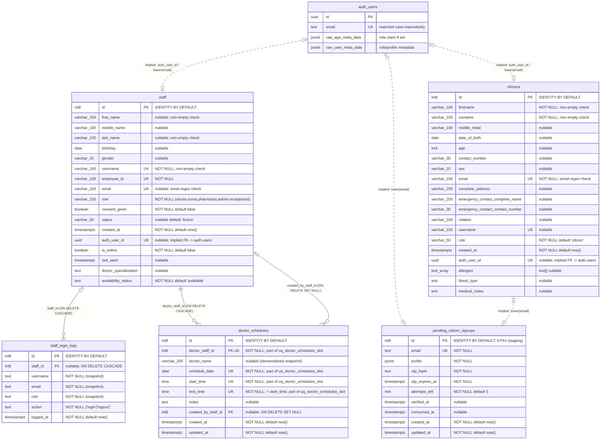
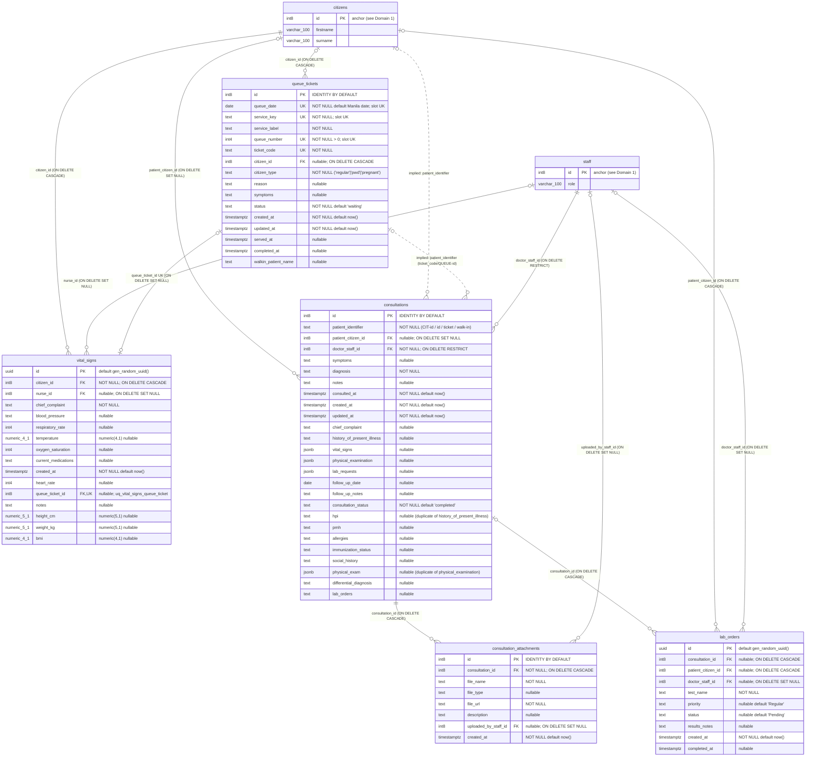
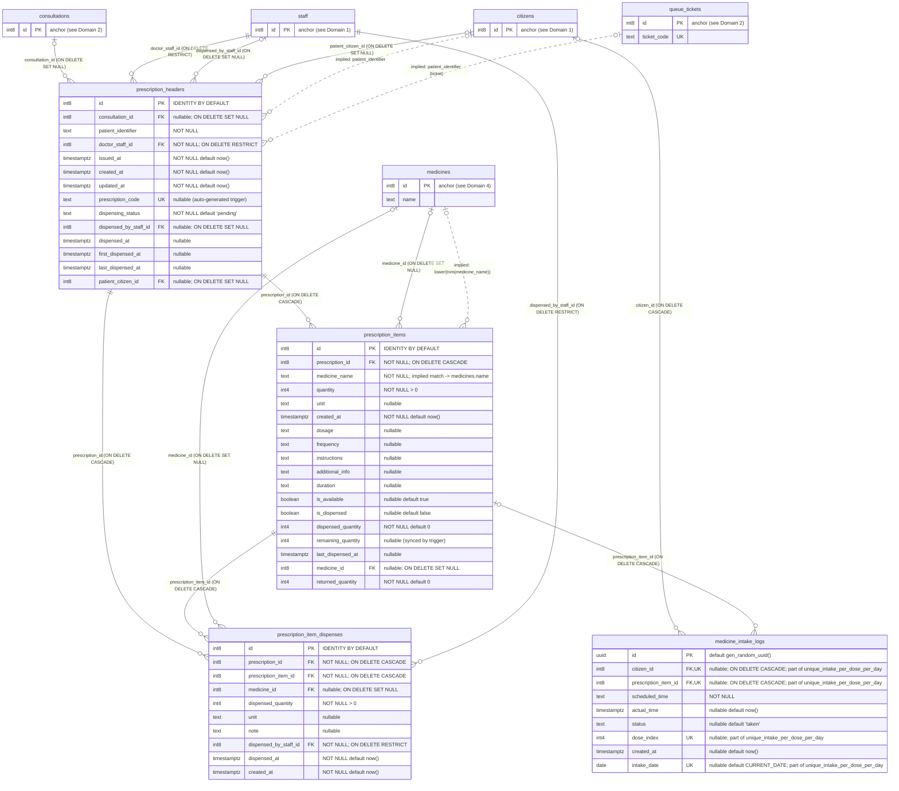
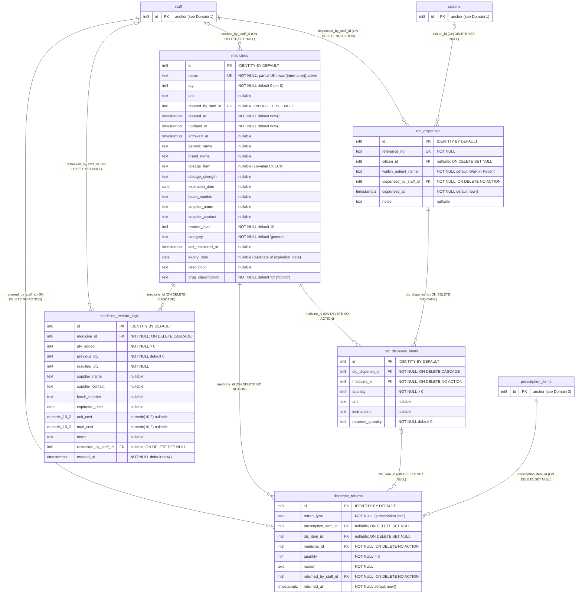

# UKonek Entity Relationship Diagrams (ERD)

> **Scope & Task Status:** Read-only architectural documentation of the live UKonek Supabase system (`UKonek_Plus`, project ref `dqjxpwbsbzagbjtulhue`, PostgreSQL 17.6.1.084). No schema, migration, data, or application code was modified.

## Sources of Truth Used

In accordance with the discovery hierarchy, the following sources were inspected and reconciled:

1. **Supabase Migrations (`supabase/migrations/`)**: All 183 local `.sql` migration files plus `supabase/apply_all_unmigrated_changes.sql` (note: `supabase/tmp_remote_schema.sql` is 0 bytes). Significant local-vs-remote migration drift was found (20 differences out of 183 records, and 4 live tables lack `CREATE TABLE` statements locally).
2. **Generated Types / ORM Models**: Confirmed **none exist** in the repository (no `database.types.ts` or ORM model layer). Manually maintained data models exist in `mobile/lib/models/*.dart`, which were inspected alongside service files.
3. **Live Database Schema (`dqjxpwbsbzagbjtulhue` via Supabase MCP)**: Queried directly as the authoritative source of truth for live tables (`24` in `public`), columns (`291`), constraints (`127`, including `42` foreign keys), indexes (`124`), RLS policies (`74` in `public`, `4` in `storage.objects`), triggers (`17`), functions (`114` non-C functions in `public`, `109` distinct names), enums (`0`), views (`0`), publications (`supabase_realtime`: `3` `public` tables), storage buckets (`1`: `promo-banners`), `pg_cron` jobs (`3`), role table grants, and `auth.users` metadata keys.
4. **Application Code Usage**: Audited all `.from()`, `.rpc()`, `.select()` embedded joins, Realtime `postgres_changes` subscriptions, and Storage / Edge Function calls across `web/src/` (`web/public/src/` is an identical build copy), `web/backend/`, `mobile/lib/`, and `supabase/functions/`.

---

## Assumptions & Diagram Conventions

1. **Authoritative Schema**: Diagrams reflect the **live `public` schema** on `dqjxpwbsbzagbjtulhue` (plus external references to `auth.users` and `storage.objects`), even where local SQL migrations or unused client code diverge (discrepancies are documented in [`findings.md`](./findings.md)).
2. **External Supabase Entities**:
   - `auth_users` represents Supabase's managed `auth.users` table (referenced by 1 enforced FK from `system_config.updated_by` and multiple un-constrained `auth_user_id` / email / UID links). Only key referenced columns are shown.
   - `storage_objects` represents `storage.objects` (`promo-banners` bucket), referenced implicitly by `announcements.image_url`.
3. **Mermaid `erDiagram` Type Aliases**: To maintain strict Mermaid syntax compatibility, parameterized SQL types with commas or brackets are normalized in attribute blocks while preserving exact Postgres types in attribute comments and [`data-dictionary.md`](./data-dictionary.md):
   - `int8` = `bigint` identity (`generated by default as identity`), `int4` = `integer`, `int2` = `smallint`
   - `varchar_N` = `character varying(N)` (e.g., `varchar_100`)
   - `numeric_P_S` = `numeric(P,S)` (e.g., `numeric_12_2`)
   - `text_array` = `text[]`
   - `boolean` = `bool`, `timestamptz` = `timestamp with time zone`, `time` = `time without time zone`
4. **Key Markers & Relationship Styles**:
   - `PK` = Primary Key, `FK` = Enforced Foreign Key constraint, `UK` = Unique constraint or unique index.
   - **Solid lines (`--`)** denote **enforced PostgreSQL `FOREIGN KEY` constraints** (`42` total), labeled with `<fk_column> (<ON DELETE behavior>)`.
   - **Dashed lines (`..`)** denote **implied (un-enforced) relationships** (`12` cross-table/external implied edges on the overview diagram, plus `2` self-contained polymorphic text columns cataloged in Part C for `14` total implied relationships), prefixed with `implied:`.
   - **Multi-domain tables**: Full 291-column definitions appear once in each table's primary domain diagram. Where a table appears in another domain purely as a referenced parent/child anchor, an abbreviated stub (`... PK/FK only`) keeps diagrams legible without omitting relationships.
5. **CLI Export Status**: `mermaid-cli` (`mmdc`) is **not installed** in this environment; therefore PNG/SVG exports were skipped and Mermaid syntax was structurally validated instead.

---

## High-Level Overview Diagram

All **24 `public` tables**, **`auth_users`** (`auth.users`), and **`storage_objects`** (`promo-banners`), showing all **42 enforced foreign keys (`--`)** and **12 inter-entity implied relationships (`..`)**.

```mermaid
erDiagram
    auth_users |o..o| staff : "implied: auth_user_id / email"
    auth_users |o..o| citizens : "implied: auth_user_id / email"
    auth_users |o--o{ system_config : "updated_by (NO ACTION)"
    auth_users |o..o{ audit_log : "implied: performed_by_auth_uid"
    auth_users |o..o| pending_citizen_signups : "implied: email during OTP signup"

    staff |o--o{ staff_login_logs : "staff_id (CASCADE)"
    staff ||--o{ doctor_schedules : "doctor_staff_id (CASCADE)"
    staff |o--o{ doctor_schedules : "created_by_staff_id (SET NULL)"
    staff |o--o{ announcements : "created_by_staff_id (SET NULL)"
    staff |o--o{ vital_signs : "nurse_id (SET NULL)"
    staff ||--o{ consultations : "doctor_staff_id (RESTRICT)"
    staff |o--o{ consultation_attachments : "uploaded_by_staff_id (SET NULL)"
    staff |o--o{ lab_orders : "doctor_staff_id (SET NULL)"
    staff ||--o{ prescription_headers : "doctor_staff_id (RESTRICT)"
    staff |o--o{ prescription_headers : "dispensed_by_staff_id (SET NULL)"
    staff ||--o{ prescription_item_dispenses : "dispensed_by_staff_id (RESTRICT)"
    staff |o--o{ medicines : "created_by_staff_id (SET NULL)"
    staff |o--o{ medicine_restock_logs : "restocked_by_staff_id (SET NULL)"
    staff ||--o{ otc_dispenses : "dispensed_by_staff_id (NO ACTION)"
    staff ||--o{ dispense_returns : "returned_by_staff_id (NO ACTION)"
    staff |o--o{ clinic_transactions : "created_by_staff_id (SET NULL)"
    staff |o--o{ audit_log : "performed_by_staff_id (SET NULL)"

    citizens |o..o| pending_citizen_signups : "implied: email staging"
    citizens |o--o{ queue_tickets : "citizen_id (CASCADE)"
    citizens ||--o{ vital_signs : "citizen_id (CASCADE)"
    citizens |o--o{ consultations : "patient_citizen_id (SET NULL)"
    citizens |o..o{ consultations : "implied: patient_identifier"
    citizens |o--o{ lab_orders : "patient_citizen_id (CASCADE)"
    citizens |o--o{ prescription_headers : "patient_citizen_id (SET NULL)"
    citizens |o..o{ prescription_headers : "implied: patient_identifier"
    citizens |o--o{ medicine_intake_logs : "citizen_id (CASCADE)"
    citizens |o--o{ otc_dispenses : "citizen_id (SET NULL)"
    citizens |o--o{ feedbacks : "citizen_id (SET NULL)"
    citizens |o..o{ feedbacks : "implied: from_email"

    queue_tickets |o--o| vital_signs : "queue_ticket_id UK (SET NULL)"
    queue_tickets |o..o{ consultations : "implied: patient_identifier (ticket)"
    queue_tickets |o..o{ prescription_headers : "implied: patient_identifier (ticket)"

    consultations ||--o{ consultation_attachments : "consultation_id (CASCADE)"
    consultations |o--o{ lab_orders : "consultation_id (CASCADE)"
    consultations |o--o{ prescription_headers : "consultation_id (SET NULL)"

    prescription_headers ||--o{ prescription_items : "prescription_id (CASCADE)"
    prescription_headers ||--o{ prescription_item_dispenses : "prescription_id (CASCADE)"
    prescription_items ||--o{ prescription_item_dispenses : "prescription_item_id (CASCADE)"
    prescription_items |o--o{ medicine_intake_logs : "prescription_item_id (CASCADE)"
    prescription_items |o--o{ dispense_returns : "prescription_item_id (SET NULL)"

    medicines |o--o{ prescription_items : "medicine_id (SET NULL)"
    medicines |o..o{ prescription_items : "implied: medicine_name"
    medicines |o--o{ prescription_item_dispenses : "medicine_id (SET NULL)"
    medicines ||--o{ medicine_restock_logs : "medicine_id (CASCADE)"
    medicines ||--o{ otc_dispense_items : "medicine_id (NO ACTION)"
    medicines ||--o{ dispense_returns : "medicine_id (NO ACTION)"

    otc_dispenses ||--o{ otc_dispense_items : "otc_dispense_id (CASCADE)"
    otc_dispense_items |o--o{ dispense_returns : "otc_item_id (SET NULL)"

    storage_objects |o..o| announcements : "implied: image_url (promo-banners)"
```

---

## Domain 1: Identity, Accounts & Doctor Scheduling

**Tables (5 `public` + `auth_users`):** `staff`, `staff_login_logs`, `citizens`, `pending_citizen_signups`, `doctor_schedules`.

---

## Domain 2: Queueing, Triage & Clinical Encounters

**Tables (5 core + `citizens` / `staff` anchors):** `queue_tickets`, `vital_signs`, `consultations`, `consultation_attachments`, `lab_orders`.

---

## Domain 3: Prescriptions, Dispensing & Citizen Adherence

**Tables (4 core + `citizens`, `staff`, `consultations`, `queue_tickets`, `medicines` anchors):** `prescription_headers`, `prescription_items`, `prescription_item_dispenses`, `medicine_intake_logs`.

> **M:N Resolution:** `prescription_headers` has a many-to-many relationship with `medicines` resolved through the associative junction table `prescription_items` (where `medicine_id` is nullable for unlinked/free-text prescribed items), and individual fulfillment batches are tracked in `prescription_item_dispenses`.

---

## Domain 4: Pharmacy Inventory, OTC Dispensing & Returns

**Tables (5 core + `staff`, `citizens`, `prescription_items` anchors):** `medicines`, `medicine_restock_logs`, `otc_dispenses`, `otc_dispense_items`, `dispense_returns`.

> **M:N Resolution:** `otc_dispenses` has a many-to-many relationship with `medicines` resolved via `otc_dispense_items`. Returns of either prescribed or OTC items are unified into `dispense_returns`.

---

## Domain 5: Clinic Operations, Engagement, Audit & Configuration

**Tables (5 `public` + `auth_users`, `staff`, `citizens`, `storage_objects` anchors):** `announcements`, `feedbacks`, `clinic_transactions`, `audit_log`, `system_config`.

```mermaid
erDiagram
    auth_users {
        uuid id PK "anchor (auth.users)"
    }

    staff {
        int8 id PK "anchor (see Domain 1)"
    }

    citizens {
        int8 id PK "anchor (see Domain 1)"
        varchar_100 email UK
    }

    storage_objects {
        uuid id PK "storage.objects (promo-banners bucket)"
        text bucket_id
        text name
    }

    announcements {
        int8 id PK "IDENTITY BY DEFAULT"
        text title "NOT NULL"
        text content "NOT NULL"
        int8 created_by_staff_id FK "nullable; ON DELETE SET NULL"
        timestamptz created_at "NOT NULL default now()"
        timestamptz updated_at "NOT NULL default now()"
        varchar_20 visibility "NOT NULL default 'all' ('all'|'staff'|'citizen')"
        text image_url "nullable; implied -> promo-banners storage object"
    }

    feedbacks {
        int8 id PK "IDENTITY BY DEFAULT"
        int8 citizen_id FK "nullable; ON DELETE SET NULL"
        text from_email "NOT NULL"
        text subject "NOT NULL"
        text message "NOT NULL"
        int2 rating "nullable (1..5 CHECK)"
        timestamptz created_at "NOT NULL default now()"
        timestamptz updated_at "NOT NULL default now()"
    }

    clinic_transactions {
        int8 id PK "IDENTITY BY DEFAULT"
        text transaction_type "NOT NULL ('income'|'expense')"
        text category "NOT NULL"
        numeric_12_2 amount "numeric(12,2) NOT NULL >= 0"
        text description "nullable"
        text reference_id "nullable (implied polymorphic ref)"
        date transaction_date "NOT NULL default CURRENT_DATE"
        int8 created_by_staff_id FK "nullable; ON DELETE SET NULL"
        timestamptz created_at "NOT NULL default now()"
        timestamptz updated_at "NOT NULL default now()"
    }

    audit_log {
        int8 id PK "IDENTITY BY DEFAULT"
        text action "NOT NULL"
        text entity_type "NOT NULL (implied polymorphic target)"
        text entity_id "nullable (implied polymorphic target ID)"
        jsonb details "nullable"
        int8 performed_by_staff_id FK "nullable; ON DELETE SET NULL"
        uuid performed_by_auth_uid "nullable; implied FK -> auth.users.id"
        text ip_address "nullable"
        timestamptz created_at "NOT NULL default now()"
    }

    system_config {
        text config_key PK "NOT NULL"
        text config_value "NOT NULL"
        text description "nullable"
        timestamptz updated_at "nullable default now()"
        uuid updated_by FK "nullable; -> auth.users(id) ON DELETE NO ACTION"
    }

    staff |o--o{ announcements : "created_by_staff_id (ON DELETE SET NULL)"
    storage_objects |o..o| announcements : "implied: image_url (promo-banners)"
    citizens |o--o{ feedbacks : "citizen_id (ON DELETE SET NULL)"
    citizens |o..o{ feedbacks : "implied: from_email"
    staff |o--o{ clinic_transactions : "created_by_staff_id (ON DELETE SET NULL)"
    staff |o--o{ audit_log : "performed_by_staff_id (ON DELETE SET NULL)"
    auth_users |o..o{ audit_log : "implied: performed_by_auth_uid"
    auth_users |o--o{ system_config : "updated_by (ON DELETE NO ACTION)"
```

---

## Relationship Catalog

### Part A: All 42 Enforced Foreign Key Constraints

Every constraint below was verified via `pg_constraint` (`contype = 'f'`) and `pg_index`.

| # | Source (Child) Table.Column | Target (Parent) Table.Column | Cardinality (Parent : Child) | Child Nullability | `ON DELETE` | `ON UPDATE` | Indexed? | Constraint Name |
|---:|---|---|---|---|---|---|---|---|
| 1 | `announcements.created_by_staff_id` | `public.staff.id` | 1 : 0..N | Optional (NULL) | `SET NULL` | `NO ACTION` | No | `announcements_created_by_staff_id_fkey` |
| 2 | `audit_log.performed_by_staff_id` | `public.staff.id` | 1 : 0..N | Optional (NULL) | `SET NULL` | `NO ACTION` | Yes | `audit_log_performed_by_staff_id_fkey` |
| 3 | `clinic_transactions.created_by_staff_id` | `public.staff.id` | 1 : 0..N | Optional (NULL) | `SET NULL` | `NO ACTION` | No | `clinic_transactions_created_by_staff_id_fkey` |
| 4 | `consultation_attachments.consultation_id` | `public.consultations.id` | 1 : 0..N | Mandatory (NOT NULL) | `CASCADE` | `NO ACTION` | Yes | `consultation_attachments_consultation_id_fkey` |
| 5 | `consultation_attachments.uploaded_by_staff_id` | `public.staff.id` | 1 : 0..N | Optional (NULL) | `SET NULL` | `NO ACTION` | No | `consultation_attachments_uploaded_by_staff_id_fkey` |
| 6 | `consultations.doctor_staff_id` | `public.staff.id` | 1 : 0..N | Mandatory (NOT NULL) | `RESTRICT` | `NO ACTION` | Yes | `consultations_doctor_staff_id_fkey` |
| 7 | `consultations.patient_citizen_id` | `public.citizens.id` | 1 : 0..N | Optional (NULL) | `SET NULL` | `NO ACTION` | Yes | `consultations_patient_citizen_id_fkey` |
| 8 | `dispense_returns.medicine_id` | `public.medicines.id` | 1 : 0..N | Mandatory (NOT NULL) | `NO ACTION` | `NO ACTION` | Yes | `dispense_returns_medicine_id_fkey` |
| 9 | `dispense_returns.otc_item_id` | `public.otc_dispense_items.id` | 1 : 0..N | Optional (NULL) | `SET NULL` | `NO ACTION` | No | `dispense_returns_otc_item_id_fkey` |
| 10 | `dispense_returns.prescription_item_id` | `public.prescription_items.id` | 1 : 0..N | Optional (NULL) | `SET NULL` | `NO ACTION` | Yes | `dispense_returns_prescription_item_id_fkey` |
| 11 | `dispense_returns.returned_by_staff_id` | `public.staff.id` | 1 : 0..N | Mandatory (NOT NULL) | `NO ACTION` | `NO ACTION` | Yes | `dispense_returns_returned_by_staff_id_fkey` |
| 12 | `doctor_schedules.created_by_staff_id` | `public.staff.id` | 1 : 0..N | Optional (NULL) | `SET NULL` | `NO ACTION` | No | `doctor_schedules_created_by_staff_id_fkey` |
| 13 | `doctor_schedules.doctor_staff_id` | `public.staff.id` | 1 : 0..N | Mandatory (NOT NULL) | `CASCADE` | `NO ACTION` | Yes | `doctor_schedules_doctor_staff_id_fkey` |
| 14 | `feedbacks.citizen_id` | `public.citizens.id` | 1 : 0..N | Optional (NULL) | `SET NULL` | `NO ACTION` | No | `feedbacks_citizen_id_fkey` |
| 15 | `lab_orders.consultation_id` | `public.consultations.id` | 1 : 0..N | Optional (NULL) | `CASCADE` | `NO ACTION` | Yes | `lab_orders_consultation_id_fkey` |
| 16 | `lab_orders.doctor_staff_id` | `public.staff.id` | 1 : 0..N | Optional (NULL) | `SET NULL` | `NO ACTION` | No | `lab_orders_doctor_staff_id_fkey` |
| 17 | `lab_orders.patient_citizen_id` | `public.citizens.id` | 1 : 0..N | Optional (NULL) | `CASCADE` | `NO ACTION` | Yes | `lab_orders_patient_citizen_id_fkey` |
| 18 | `medicine_intake_logs.citizen_id` | `public.citizens.id` | 1 : 0..N | Optional (NULL) | `CASCADE` | `NO ACTION` | Yes | `medicine_intake_logs_citizen_id_fkey` |
| 19 | `medicine_intake_logs.prescription_item_id` | `public.prescription_items.id` | 1 : 0..N | Optional (NULL) | `CASCADE` | `NO ACTION` | No | `medicine_intake_logs_prescription_item_id_fkey` |
| 20 | `medicine_restock_logs.medicine_id` | `public.medicines.id` | 1 : 0..N | Mandatory (NOT NULL) | `CASCADE` | `NO ACTION` | Yes | `medicine_restock_logs_medicine_id_fkey` |
| 21 | `medicine_restock_logs.restocked_by_staff_id` | `public.staff.id` | 1 : 0..N | Optional (NULL) | `SET NULL` | `NO ACTION` | No | `medicine_restock_logs_restocked_by_staff_id_fkey` |
| 22 | `medicines.created_by_staff_id` | `public.staff.id` | 1 : 0..N | Optional (NULL) | `SET NULL` | `NO ACTION` | No | `medicines_created_by_staff_id_fkey` |
| 23 | `otc_dispense_items.medicine_id` | `public.medicines.id` | 1 : 0..N | Mandatory (NOT NULL) | `NO ACTION` | `NO ACTION` | Yes | `otc_dispense_items_medicine_id_fkey` |
| 24 | `otc_dispense_items.otc_dispense_id` | `public.otc_dispenses.id` | 1 : 0..N | Mandatory (NOT NULL) | `CASCADE` | `NO ACTION` | Yes | `otc_dispense_items_otc_dispense_id_fkey` |
| 25 | `otc_dispenses.citizen_id` | `public.citizens.id` | 1 : 0..N | Optional (NULL) | `SET NULL` | `NO ACTION` | Yes | `otc_dispenses_citizen_id_fkey` |
| 26 | `otc_dispenses.dispensed_by_staff_id` | `public.staff.id` | 1 : 0..N | Mandatory (NOT NULL) | `NO ACTION` | `NO ACTION` | Yes | `otc_dispenses_dispensed_by_staff_id_fkey` |
| 27 | `prescription_headers.consultation_id` | `public.consultations.id` | 1 : 0..N | Optional (NULL) | `SET NULL` | `NO ACTION` | Yes | `prescription_headers_consultation_id_fkey` |
| 28 | `prescription_headers.dispensed_by_staff_id` | `public.staff.id` | 1 : 0..N | Optional (NULL) | `SET NULL` | `NO ACTION` | No | `prescription_headers_dispensed_by_staff_id_fkey` |
| 29 | `prescription_headers.doctor_staff_id` | `public.staff.id` | 1 : 0..N | Mandatory (NOT NULL) | `RESTRICT` | `NO ACTION` | Yes | `prescription_headers_doctor_staff_id_fkey` |
| 30 | `prescription_headers.patient_citizen_id` | `public.citizens.id` | 1 : 0..N | Optional (NULL) | `SET NULL` | `NO ACTION` | Yes | `prescription_headers_patient_citizen_id_fkey` |
| 31 | `prescription_item_dispenses.dispensed_by_staff_id` | `public.staff.id` | 1 : 0..N | Mandatory (NOT NULL) | `RESTRICT` | `NO ACTION` | Yes | `prescription_item_dispenses_dispensed_by_staff_id_fkey` |
| 32 | `prescription_item_dispenses.medicine_id` | `public.medicines.id` | 1 : 0..N | Optional (NULL) | `SET NULL` | `NO ACTION` | No | `prescription_item_dispenses_medicine_id_fkey` |
| 33 | `prescription_item_dispenses.prescription_id` | `public.prescription_headers.id` | 1 : 0..N | Mandatory (NOT NULL) | `CASCADE` | `NO ACTION` | Yes | `prescription_item_dispenses_prescription_id_fkey` |
| 34 | `prescription_item_dispenses.prescription_item_id` | `public.prescription_items.id` | 1 : 0..N | Mandatory (NOT NULL) | `CASCADE` | `NO ACTION` | Yes | `prescription_item_dispenses_prescription_item_id_fkey` |
| 35 | `prescription_items.medicine_id` | `public.medicines.id` | 1 : 0..N | Optional (NULL) | `SET NULL` | `NO ACTION` | Yes | `prescription_items_medicine_id_fkey` |
| 36 | `prescription_items.prescription_id` | `public.prescription_headers.id` | 1 : 0..N | Mandatory (NOT NULL) | `CASCADE` | `NO ACTION` | Yes | `prescription_items_prescription_id_fkey` |
| 37 | `queue_tickets.citizen_id` | `public.citizens.id` | 1 : 0..N | Optional (NULL) | `CASCADE` | `NO ACTION` | Yes | `queue_tickets_citizen_id_fkey` |
| 38 | `staff_login_logs.staff_id` | `public.staff.id` | 1 : 0..N | Optional (NULL) | `CASCADE` | `NO ACTION` | Yes | `staff_login_logs_staff_id_fkey` |
| 39 | `system_config.updated_by` | `auth.users.id` | 1 : 0..N | Optional (NULL) | `NO ACTION` | `NO ACTION` | No | `system_config_updated_by_fkey` |
| 40 | `vital_signs.citizen_id` | `public.citizens.id` | 1 : 0..N | Mandatory (NOT NULL) | `CASCADE` | `NO ACTION` | Yes | `vital_signs_citizen_id_fkey` |
| 41 | `vital_signs.nurse_id` | `public.staff.id` | 1 : 0..N | Optional (NULL) | `SET NULL` | `NO ACTION` | No | `vital_signs_nurse_id_fkey` |
| 42 | `vital_signs.queue_ticket_id` | `public.queue_tickets.id` | **0..1 : 0..1** (`uq_vital_signs_queue_ticket`) | Optional (NULL) | `SET NULL` | `NO ACTION` | Yes (UK) | `vital_signs_queue_ticket_id_fkey` |

---

### Part B: Many-to-Many (M:N) Relationships Through Junction Tables

| Entity A | Entity B | Junction / Associative Table | Notes |
|---|---|---|---|
| `prescription_headers` | `medicines` | `prescription_items` | Optional `medicine_id` (NULL allowed for free-text medicines; fallback lookup by `medicine_name`). |
| `prescription_headers` / `prescription_items` | `staff` (Pharmacists) & `medicines` | `prescription_item_dispenses` | Partial/multi-event dispensing ledger linking items, medicines, and dispensing staff. |
| `citizens` | `prescription_items` | `medicine_intake_logs` | Dose adherence log (`unique_intake_per_dose_per_day(citizen_id, prescription_item_id, dose_index, intake_date)`). |
| `otc_dispenses` | `medicines` | `otc_dispense_items` | Line items for each over-the-counter dispense batch (`ON DELETE CASCADE` from header, `NO ACTION` from medicine). |

---

### Part C: Implied (Un-enforced) Relationships

These relationships exist in RLS policies, database RPCs, Edge Functions, or client application queries, **without** a PostgreSQL `FOREIGN KEY` constraint:

| # | Source / Referencing Column(s) | Target Entity.Column | Expected Cardinality | Where Used / Enforced |
|---:|---|---|---|---|
| 1 | `staff.auth_user_id` (`uuid`, `UK`) & `staff.email` (`UK`) | `auth.users(id)` / `auth.users(email)` | 0..1 : 0..1 | RLS policies, `is_admin()`, `is_active_staff()`, `get_staff_role()`, `delete_staff_member()`, `update_staff_account_admin()`. |
| 2 | `citizens.auth_user_id` (`uuid`, `UK`) & `citizens.email` (`UK`) | `auth.users(id)` / `auth.users(email)` | 0..1 : 0..1 | RLS (`citizens_select_own`), `link_my_citizen_auth_by_email()`, Edge Function `citizen-complete-signup`, mobile `AuthService`. |
| 3 | `pending_citizen_signups.email` (`text`, `UK`) | `citizens.email` | 0..1 : 0..1 | Edge Functions (`citizen-request-otp`, `citizen-verify-otp`, `citizen-complete-signup`) check duplicate emails before creating citizen profile. |
| 4 | `pending_citizen_signups.email` (`text`, `UK`) | `auth.users(email)` | 0..1 : 0..1 | Edge Functions `citizen-request-otp` & `citizen-complete-signup` look up / create `auth.users`. |
| 5 | `audit_log.performed_by_auth_uid` (`uuid`) | `auth.users(id)` | 0..1 : 0..N | Audit actor UUID (when populated alongside or instead of `performed_by_staff_id`). |
| 6 | `audit_log.(entity_type, entity_id)` | Polymorphic (`any` table PK) | 1 : 0..N | Indexed polymorphic target reference (`idx_audit_log_entity`). |
| 7 | `consultations.patient_identifier` (`text`) | `citizens.id` (`'<id>'`, `'CIT-<id>'`) | 0..1 : 0..N | RLS `consultations_select_own_citizen`, `usersController.js`, `health-records.js`, `merge_walkin_to_citizen()`. |
| 8 | `consultations.patient_identifier` (`text`) | `queue_tickets.(id, ticket_code)` | 0..1 : 0..N | RLS `consultations_select_own_citizen` matches `ticket_code`, `'QUEUE-' || qt.id`, or `qt.id::text`. |
| 9 | `prescription_headers.patient_identifier` (`text`) | `citizens.id` (`'<id>'`, `'CIT-<id>'`) | 0..1 : 0..N | RLS `prescription_headers_select_own_citizen`, `get_my_prescribed_medicines()`, `get_my_prescription_dispense_logs()`, `usersController.js`. |
| 10 | `prescription_headers.patient_identifier` (`text`) | `queue_tickets.(id, ticket_code)` | 0..1 : 0..N | RLS `prescription_headers_select_own_citizen`, `get_my_prescription_dispense_logs()`. |
| 11 | `prescription_items.medicine_name` (`text`) | `medicines.name` (`text`) | 0..1 : 0..N | `dispense_prescription_items()` & `return_dispensed_prescription_item()` fall back to `lower(trim(m.name))` when `medicine_id IS NULL`. |
| 12 | `feedbacks.from_email` (`text`) | `citizens.email` | 0..1 : 0..N | Correlates feedback sender email with `citizens` when `citizen_id` is NULL or in UI fallbacks. |
| 13 | `announcements.image_url` (`text`) | `storage.objects` (`promo-banners`) | 0..1 : 0..1 | `promoPosterController.js` uploads banners to bucket `promo-banners` and stores public URL in `image_url`. |
| 14 | `clinic_transactions.reference_id` (`text`) | Polymorphic external/source ID | 0..1 : 0..N | Free-text transaction reference (`get_financial_summary()`). |

*(Also note denormalized column snapshots backed by real FKs: `doctor_schedules.doctor_name` duplicates `staff` name alongside `doctor_staff_id`, and `staff_login_logs.(username, email, role)` snapshot `staff` attributes alongside `staff_id`.)*
